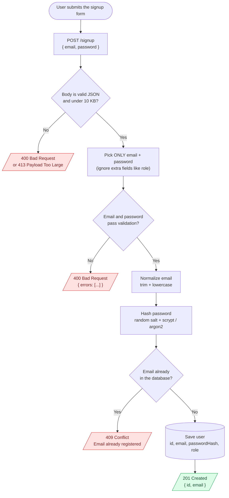
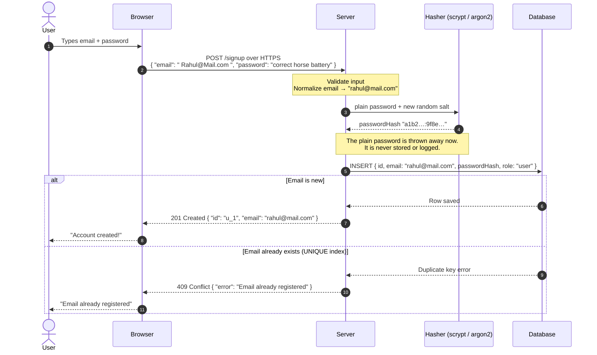

# 06. Signup

## Notes

### What is signup?

**Signup** (also called **registration**) is how a new user **creates an account**. The user gives you some details (usually email + password), and you **save them safely** so they can log in later.

It sounds simple: "just save the email and password in a database". But a careless signup is one of the easiest ways to leak passwords or let attackers abuse your app.

In Level 0 you learned the building blocks. Signup is where you **use them together for the first time**:

| Level 0 topic | How signup uses it |
|---|---|
| 01 AuthN vs AuthZ | Signup creates the **identity** that authentication will check later |
| 02 HTTP basics | `POST` request, JSON body, and status codes `201`, `400`, `409` |
| 03 Hashing | Passwords are **hashed**, never encrypted or stored in plain text |
| 04 Password hashing | Use **argon2 / bcrypt / scrypt** with a random **salt** |
| 05 HTTPS | The password travels over the network, so HTTPS is a must |

---

### Real-life example: opening a bank account

When you open a bank account:

1. You fill out a **form** with your details → the client sends a **signup request**
2. The clerk **checks the form**: is the phone number valid? is anything missing? → **validation**
3. The clerk checks you **don't already have an account** → **duplicate check**
4. You set a **secret PIN**, and the bank stores it so that **even bank staff can't see it** → **password hashing**
5. Your account is created, and you get a **welcome letter** → **201 Created** response
6. Later, the bank asks you to **verify your phone number** → **email verification** (topic 12)

---

### The signup flow, step by step

#### Flow diagram: every decision the server makes



#### Data flow: who sends what to whom



#### Where does the password live? 🔍

Follow the password through the whole journey:

| Place | What's there | Safe? |
|---|---|---|
| User's keyboard → browser | `correct horse battery` (plain) | ✅ It's the user's own device |
| Network | Encrypted by HTTPS, so it looks like random bytes | ✅ Because of HTTPS (topic 05) |
| Server memory | `correct horse battery` (plain), for a few milliseconds only | ⚠️ Never log it! |
| Database | `a1b2…:9f8e…` (salt + hash only) | ✅ Can't be reversed |
| Response to the browser | Nothing. Only `{ id, email }` | ✅ |

Let's go through each step.

---

### Step 1: Accept data only with `POST` + JSON over HTTPS

- Use **`POST /signup`** (or `POST /users`). Never `GET`, because a GET request puts the data in the **URL**, which ends up in logs and browser history.
- The body is **JSON**: `{ "email": "...", "password": "..." }`
- **HTTPS only** (topic 05). The plain password travels in this request.
- **Limit the body size** (for example 10 KB). Otherwise someone can send a 1 GB request and crash your server.

---

### Step 2: Validate everything (never trust the client)

The frontend may already check the form, but **attackers don't use your frontend**. They can send anything with Postman or curl. So the **server must validate again**.

#### Email validation

| Check | Why |
|---|---|
| It exists and is a **string** | `{ "email": 123 }` or `{ "email": ["a"] }` should not crash your code |
| It **looks like** an email (`something@something.something`) | Catches typos like `rahulmail.com` |
| Max length (**254** characters) | The real limit for email addresses, and it stops huge inputs |

> Don't write a giant "perfect" email regex. The only real proof that an email works is **sending a verification email to it** (topic 12).

#### Password rules (modern NIST guidelines)

The old rules like "must have 1 uppercase, 1 number, 1 symbol, and change it every 90 days" are now **known to be bad**. People just write `Password1!`. Modern guidelines (NIST SP 800-63B) say:

| ✅ Do | ❌ Don't |
|---|---|
| Require **at least 8 characters** (12+ is even better) | Force a mix of uppercase / numbers / symbols |
| Allow **long** passwords (at least **64** characters) | Set a tiny max length like 12 or 16 |
| Allow **any character**, including spaces and emoji | Block special characters or spaces |
| **Block common and leaked passwords** (`123456`, `password`, ...) | Ask for "password hints" |
| Allow **paste** (password managers need it) | Force regular password changes for no reason |

💡 **Passphrases are great:** `correct horse battery staple` is long, easy to remember, and hard to crack.

**Blocking leaked passwords:** services like **Have I Been Pwned** have lists of billions of leaked passwords. You can check passwords against them safely without sending the password itself (through their k-anonymity API). At minimum, block a list of the most common passwords.

#### Return clear validation errors

```http
HTTP/1.1 400 Bad Request
Content-Type: application/json

{
  "errors": [
    "Email is not valid",
    "Password must be at least 8 characters"
  ]
}
```

---

### Step 3: Normalize the email

To your database, these are **three different strings**, but to the user they're the **same email**:

```
"Rahul@Mail.com"
"rahul@mail.com"
" rahul@mail.com "
```

Without normalization, one person could create **three accounts**, and later wonder why login "doesn't work".

👉 **Always `trim()` and convert to `lowercase` before saving AND before looking up the email** (at signup, login, password reset, and so on).

```js
const email = req.body.email.trim().toLowerCase();
```

> ⚠️ Don't remove dots or `+tags` (like `rahul+shop@gmail.com`). That rule only applies to Gmail and can break other providers.

---

### Step 4: Hash the password (topic 04)

```js
const passwordHash = await argon2.hash(password); // salt is added automatically
```

- **Never** store the plain password, not even "temporarily"
- **Never** log it. Be careful with `console.log(req.body)`!
- Use the **async** version of the hash function. Hashing takes about 250 ms, and the sync version **blocks your whole server** for every other user during that time.

---

### Step 5: Save the user, and make the email unique

#### What to store

```js
{
  id: "u_8f3k2",                   // random ID (UUID), not the email
  email: "rahul@mail.com",          // normalized
  passwordHash: "$argon2id$v=19$...",
  emailVerified: false,             // becomes true after topic 12
  createdAt: "2026-11-04T10:30:00Z"
}
```

| ✅ Store | ❌ Never store |
|---|---|
| Normalized email | Plain password |
| Password **hash** | "Encrypted" password |
| `emailVerified`, `createdAt`, `role` | Password hints or security answers in plain text |

#### Duplicate emails: use a UNIQUE constraint

The beginner approach:

```js
// ❌ Race condition!
if (await db.findUser(email)) return res.status(409)...;
await db.createUser(email, hash);
```

What if **two signup requests** for the same email arrive at the **same moment**? Both check, both see "no user yet", and both create one. Now you have **two accounts with one email**. 😱

👉 **Fix:** add a **UNIQUE index** on the email column in your database, and handle the "duplicate key" error:

```sql
CREATE UNIQUE INDEX users_email_unique ON users (email);
```

The database guarantees that only one row can ever have that email, no matter how many requests arrive at once.

---

### Step 6: Send the right response

| Situation | Status code | Response body |
|---|---|---|
| Account created | **201 Created** | `{ "id": "u_1", "email": "rahul@mail.com" }` |
| Invalid input | **400 Bad Request** | `{ "errors": [...] }` |
| Request body too big | **413 Payload Too Large** | `{ "error": "Request body too large" }` |
| Email already registered | **409 Conflict** | `{ "error": "Email already registered" }` (see the note below) |
| Too many signups from one IP | **429 Too Many Requests** | Rate limiting (topic 16) |
| Server bug | **500 Internal Server Error** | A generic message, **never** the stack trace |

**Never** send back the password or the `passwordHash`, even though it's "just a hash".

---

### 🤔 The tricky part: "Email already registered" leaks information

If signup says **"This email is already registered"**, an attacker can use your signup form to **check which emails have accounts** on your site. This is called **account enumeration** (or user enumeration).

Why it matters:
- On a sensitive site (health, dating, finance), just **knowing someone has an account** is private information
- Attackers can build a list of real users to target with **phishing** or **password guessing**

#### Two approaches

| | Simple approach | Safer approach |
|---|---|---|
| Response for a new email | `201` "Account created" | `202` "Check your email to continue" |
| Response for an existing email | `409` "Email already registered" | **The same** `202` "Check your email to continue" |
| What happens behind the scenes | Nothing | New email: verification link. Existing email: a "someone tried to sign up with your email, did you mean to log in?" message |
| User experience | Easier and clearer | One extra step |
| Used by | Most apps | Security-sensitive apps |

👉 **For learning and most apps, the simple approach (409) is fine.** Just know the trade-off, and add **rate limiting** (topic 16) so attackers can't check thousands of emails quickly. Interviewers love this question.

---

### After signup: what next?

1. **Email verification** (topic 12): prove the user really owns that email
2. **Log them in automatically, or ask them to log in** (topic 07): both are common
3. **Send a welcome email**: optional

---

### Common beginner mistakes

1. **Storing plain-text passwords.**
   The #1 mistake. Always hash with argon2, bcrypt, or scrypt.

2. **Only validating on the frontend.**
   Attackers skip your frontend. Validate on the server.

3. **Not normalizing emails.**
   `Rahul@Mail.com` and `rahul@mail.com` become two accounts.

4. **Checking for duplicates without a UNIQUE index.**
   Two requests at once can create duplicate accounts.

5. **Returning the password hash in the response.**
   Pick the exact fields to return: `{ id, email }`.

6. **Logging the request body.**
   `console.log(req.body)` writes plain passwords into your logs.

7. **Old-style password rules** (forcing symbols, tiny max length, blocking paste).
   They make passwords weaker. Use length + a blocklist instead.

8. **Using sync hashing** (`bcrypt.hashSync`, `scryptSync`) in a server.
   It freezes your server for every user while it hashes.

9. **Trusting extra fields from the client.**
   If you do `db.createUser(req.body)` and the attacker sends `{ "role": "admin" }`, they just made themselves an admin! This is called **mass assignment**. Pick only the fields you expect: `email` and `password`.

10. **No rate limiting.**
    Bots can create thousands of fake accounts. Add rate limiting and, if needed, a CAPTCHA.

---

### Interview questions

1. **Walk me through what happens when a user signs up.**
   Validate input on the server, normalize the email, hash the password with argon2/bcrypt, save the user with a unique email constraint, return `201` with safe fields only, and then send a verification email.

2. **How do you store passwords?**
   As a salted, slow hash (argon2id / bcrypt / scrypt). Never plain text and never encrypted.

3. **What status code do you return for a successful signup? And for a duplicate email?**
   `201 Created` for success. `409 Conflict` for a duplicate email (or a generic `202` to prevent enumeration).

4. **What is account enumeration, and how can signup cause it?**
   When an attacker can find out which emails are registered. A signup form that says "email already exists" reveals it. Fix it with a generic response plus an email to the address, and add rate limiting.

5. **Two users sign up with the same email at the same time. What happens?**
   Without a unique constraint, both can succeed (a race condition). A UNIQUE index on the email column makes the database reject the second one.

6. **What password rules would you enforce?**
   Follow NIST: at least 8 characters, allow at least 64, allow all characters, block common/breached passwords, no forced complexity rules, and no forced periodic changes.

7. **Why normalize emails?**
   So the same address with different case or spaces maps to one account, and login lookups match.

8. **What is mass assignment?**
   Passing the whole request body into your database create/update call, so attackers can set fields like `role` or `isAdmin`. Fix it by picking only allowed fields.

---

### Quick recap

- Signup = **validate → normalize → hash → save (unique) → 201**
- **Validate on the server**, always. Never trust the frontend.
- Password rules: **min 8, allow long passwords, block common ones**, no forced symbols
- **Normalize** emails: `trim()` + `toLowerCase()`
- **Hash** with argon2 / bcrypt / scrypt using the **async** version
- **UNIQUE index** on email, to handle race conditions
- Return `201` with `{ id, email }` only, **never** the hash
- "Email already exists" can leak who has accounts (**enumeration**)

## Code

A small signup API using only Node.js built-ins: `http` for the server and `crypto.scrypt` for hashing (from topic 04). Users are kept in memory, so they disappear when you restart. A real app would use a database.

📄 **Full code: [server.js](server.js)**. Open it and read the comments, which follow the same steps as the notes above.

```bash
node server.js
```

### Try it

✅ **Successful signup:** the email gets normalized, and only safe fields come back.

```bash
curl -i -X POST http://localhost:3000/signup -H "Content-Type: application/json" -d '{"email":" Rahul@Mail.com ","password":"correct horse battery"}'
```
→ `201 Created` with `{"id":"...","email":"rahul@mail.com"}`

❌ **Same email, different case:** caught because of normalization.

```bash
curl -i -X POST http://localhost:3000/signup -H "Content-Type: application/json" -d '{"email":"RAHUL@mail.com","password":"another long password"}'
```
→ `409 Conflict` with `{"error":"Email already registered"}`

❌ **Bad email + short password:** all errors are returned together.

```bash
curl -i -X POST http://localhost:3000/signup -H "Content-Type: application/json" -d '{"email":"rahulmail.com","password":"abc"}'
```
→ `400 Bad Request` with `{"errors":["Email is not valid","Password must be at least 8 characters"]}`

❌ **Common password:**

```bash
curl -i -X POST http://localhost:3000/signup -H "Content-Type: application/json" -d '{"email":"priya@mail.com","password":"password1"}'
```
→ `400 Bad Request` with `{"errors":["This password is too common, please choose another"]}`

🛡️ **Trying to make yourself an admin (mass assignment):** the extra field is ignored.

```bash
curl -i -X POST http://localhost:3000/signup -H "Content-Type: application/json" -d '{"email":"hacker@mail.com","password":"long enough pass","role":"admin"}'
```
→ `201 Created`, but the user is saved with `role: "user"`, because the server only reads `email` and `password`.

❌ **Broken JSON:**

```bash
curl -i -X POST http://localhost:3000/signup -H "Content-Type: application/json" -d '{"email": oops'
```
→ `400 Bad Request` with `{"error":"Body must be valid JSON"}`

> **Windows PowerShell users:** the single quotes in the `-d '...'` part work in Git Bash. In PowerShell, use Git Bash, Postman, or escape the JSON quotes.
