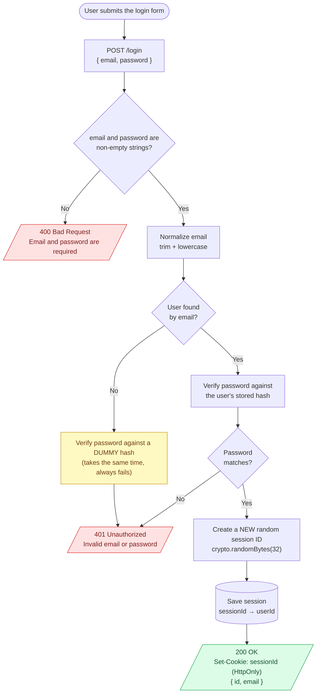
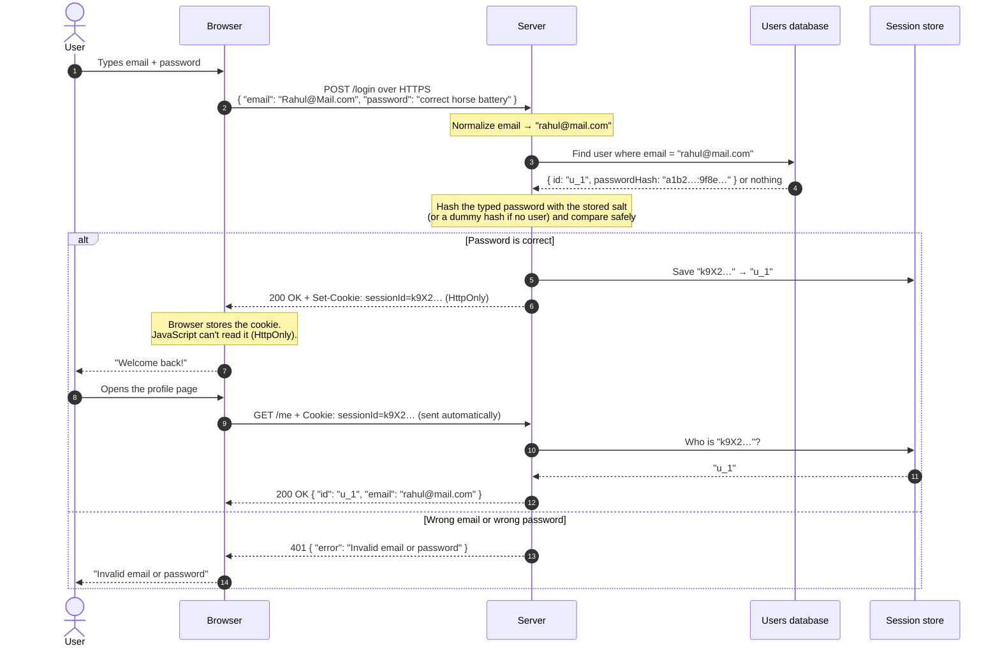

# 07. Login

## Notes

### What is login?

**Login** (also called **sign in**) is where the user **proves who they are**, usually with the email and password they chose at signup (topic 06).

This is **authentication** from topic 01: *"Who are you?"*

Login has **two jobs**:

1. **Check the credentials**: is this email + password correct?
2. **Give the user proof** that they're logged in, so they don't have to send their password on every request

Remember from topic 02: **HTTP is stateless**. The server forgets you after every request. So after a successful login, the server hands the client a **"pass"** (a session cookie or a token), and the client shows that pass on every request after that.

---

### Real-life example: a concert entry gate 🎫

1. At the gate, you show your **ticket + ID** → **email + password**
2. Security checks them against the list → **find the user + verify the password hash**
3. If everything matches, they put a **wristband** on you → **session cookie / token**
4. For the rest of the night, you just show the **wristband**, not your ticket and ID → **every request carries the cookie/token**
5. If the ticket or ID is wrong, security just says **"Sorry, you can't enter."** They don't tell you *which* part was wrong → **a generic error message**

---

### The login flow, step by step

#### Flow diagram: every decision the server makes



> 🟡 The yellow box is the **timing-attack fix** (Trap 2 below). Without it, "user not found" would answer much faster than "wrong password".

#### Data flow: who sends what to whom



#### Where does each piece of data live? 🔍

| Data | Browser | Network | Server | Database / store |
|---|---|---|---|---|
| **Password** | Typed by the user | Encrypted by HTTPS | Plain, for a few ms only (never logged) | ❌ Never stored. Only the **hash** from signup is there |
| **Password hash** | ❌ Never sent | ❌ Never sent | Read from the DB to compare | ✅ Users database |
| **Session ID** | ✅ In an `HttpOnly` cookie | Sent on every request (encrypted by HTTPS) | Looked up on every request | ✅ Session store: `sessionId → userId` |

---

### Step 1 and 2: Validate and normalize

- Use **`POST /login`**, over **HTTPS**. Never `GET`, because the password would end up in the URL and the logs.
- Check that `email` and `password` are **non-empty strings**. Don't re-apply signup rules (like "min 8 characters") here, because old accounts may have been created under different rules.
- **Normalize the email exactly as you did at signup**: `trim().toLowerCase()`. If you forget this, `Rahul@Mail.com` won't find `rahul@mail.com`, and the user thinks their password is wrong.

---

### Step 3 and 4: Find the user and verify the password

Remember from topic 04: you **never "decrypt"** the stored password. You **hash what the user typed** (with the same salt and settings) and compare:

```js
const user = await db.findUserByEmail(email);
const ok = await argon2.verify(user.passwordHash, password); // library handles salt + safe compare
```

Simple, right? But there are **two traps** hiding here.

---

### ⚠️ Trap 1: Don't tell attackers which part was wrong

```
❌ "No account found with this email"    ← tells attackers the email is NOT registered
❌ "Wrong password"                       ← tells attackers the email IS registered
✅ "Invalid email or password"            ← tells them nothing
```

Different messages let attackers **check which emails have accounts** (this is called **account enumeration**, which we also saw in topic 06). Then they can focus their password guessing on real accounts.

👉 **Use the same status code (`401`) and the exact same message for both cases.**

---

### ⚠️ Trap 2: Timing can leak the answer too

Even with the same message, look at how long each case takes:

```
Email doesn't exist  → no user → skip hashing → reply in   2 ms  ⚡
Email exists         → verify hash (slow!)    → reply in 250 ms  🐢
```

An attacker just measures the **response time**: fast means "no account", slow means "account exists". This is a **timing attack**.

👉 **Fix: always run the hash check, even when the user doesn't exist.** Compare against a **dummy hash** so both cases take the same time:

```js
const DUMMY_HASH = await argon2.hash("dummy-password-never-used"); // created once at startup

const user = await db.findUserByEmail(email);
const ok = await argon2.verify(user ? user.passwordHash : DUMMY_HASH, password);

if (!user || !ok) {
  return res.status(401).json({ error: "Invalid email or password" });
}
```

#### Real-life example: a poker face 😐

A good card player keeps the **same face** whether their cards are good or bad. Your login endpoint should look **exactly the same** (same message, same status, same time) whether the email exists or not.

---

### Step 5: Give the user proof of login

After the password checks out, the server creates a **"pass"** so the user doesn't have to send their password again. There are two main styles:

| | Session (topic 09) | Token / JWT (topics 18–23) |
|---|---|---|
| What the client gets | A **random session ID** in a cookie | A **signed token** (JWT) |
| Where user info lives | On the **server** (memory / Redis / DB) | **Inside the token** itself |
| How the client sends it | `Cookie: sessionId=...` (browser sends it automatically) | `Authorization: Bearer <token>` |
| Logout | Delete the session on the server, and it's gone | Harder (the token stays valid until it expires) |
| Common for | Websites | Mobile apps, APIs, microservices |

In this topic's code, we use the simplest version: a **random session ID in an `HttpOnly` cookie**. Topic 09 explains sessions in depth, and topic 10 explains every cookie flag.

#### Rules for the session ID / token

- Make it **long and random**: `crypto.randomBytes(32)`, **not** the user's ID or email, and not `Math.random()`
- Always create a **brand new** one on login. Never reuse one the client already had. (Reusing one allows **session fixation**: an attacker plants a known session ID on the victim's browser, the victim logs in, and now the attacker's ID is logged in too.)
- Send it in an **`HttpOnly`** cookie (JavaScript can't read it) with **`Secure`** (HTTPS only) and **`SameSite`**

---

### What to return

| Situation | Status | Response |
|---|---|---|
| Login successful | **200 OK** | `Set-Cookie` + `{ "id": "...", "email": "..." }` |
| Missing / invalid input | **400 Bad Request** | `{ "error": "Email and password are required" }` |
| Wrong email **or** password | **401 Unauthorized** | `{ "error": "Invalid email or password" }` |
| Too many attempts | **429 Too Many Requests** | Rate limiting (topic 16) |

Again: **never** return the password hash.

---

### Brute force: the attack every login page faces

Attackers will try:
- **Brute force**: many passwords against one account
- **Credential stuffing**: email + password pairs **leaked from other websites**. Many people reuse passwords, so this works scarily often.
- **Password spraying**: one common password (`Summer2026!`) against **many** accounts

Defenses (each gets its own topic later):

| Defense | Topic |
|---|---|
| **Rate limiting** (e.g. max 5 attempts per minute per IP + per account) | 16 |
| **Account lockout** / slowdown after many failures | 16 |
| **MFA** (OTP, authenticator app, passkeys) | Level 6 |
| **Blocking breached passwords** at signup | 06 |
| **Alerts** on logins from a new device or location | Level 7 |

> ⚠️ Be careful with hard lockouts ("locked for 24 hours after 5 tries"). Attackers can lock real users out on purpose. A **growing delay** or a CAPTCHA is often better.

---

### Extra things real apps do on login

- **Rehash if needed:** if the stored hash uses old or weak settings, hash the password again with new settings now (you have the plain password for a moment). See topic 04.
- **Check account status *after* the password is correct:** "email not verified", "account disabled". Showing these **before** checking the password leaks that the account exists.
- **Log the event** (time, IP, success/failure), but **never log the password**.
- **MFA step:** if the user has 2FA turned on, a correct password only gets them to the "enter your code" screen, not fully logged in (Level 6).

---

### Common beginner mistakes

1. **Different error messages** for "email not found" and "wrong password".
   Always: `401 Invalid email or password`.

2. **Skipping the hash check when the user doesn't exist.**
   Response time reveals which emails are registered. Use a dummy hash.

3. **Comparing passwords yourself with `===`.**
   Use `argon2.verify()`, `bcrypt.compare()`, or `crypto.timingSafeEqual()`.

4. **Forgetting to normalize the email** the same way as signup.
   `Rahul@Mail.com` then can't log in.

5. **Using the user ID or email as the session ID**, or generating it with `Math.random()`.
   Session IDs must be long, random, and unguessable: `crypto.randomBytes(32)`.

6. **Reusing an old session ID after login** (session fixation).
   Always create a new one.

7. **Sending the password on every request** instead of using a session or token.
   Log in once, then use the session/token.

8. **Storing the token in `localStorage`** without understanding the XSS risk.
   For websites, an `HttpOnly` cookie is usually safer (topics 10 and 19).

9. **No rate limiting.**
   Your login becomes a free password-guessing machine for bots.

10. **Logging `req.body` on failed logins** "for debugging".
    Users often type their password into the email field by mistake. Now it's in your logs.

---

### Interview questions

1. **Walk me through a login request.**
   Validate input, normalize the email, find the user, verify the password hash (with a dummy hash if no user is found), return a generic 401 on failure, and on success create a new random session or token and return it in an HttpOnly cookie or the response.

2. **Why use a generic "Invalid email or password" message?**
   To prevent account enumeration. Specific messages reveal which emails are registered.

3. **What is a timing attack on login, and how do you prevent it?**
   If unknown emails respond faster (no hashing), attackers can detect real accounts by response time. Always run the hash verification, using a dummy hash when the user doesn't exist.

4. **How does the server know you're logged in on the next request if HTTP is stateless?**
   On login, it gives the client a session ID (in a cookie) or a token. The client sends it with every request, and the server uses it to look up or verify the user.

5. **What is session fixation?**
   An attacker gets the victim to use a session ID the attacker already knows, then waits for the victim to log in. Prevent it by always creating a new session ID at login.

6. **What's the difference between brute force, credential stuffing, and password spraying?**
   Brute force: many passwords against one account. Credential stuffing: leaked email/password pairs from other sites. Spraying: one common password against many accounts.

7. **How would you protect a login endpoint from brute force?**
   Rate limiting per IP and per account, progressive delays or temporary lockouts, CAPTCHA after several failures, MFA, and breached-password checks.

8. **Should login return 401 or 403 for a wrong password?**
   401. The user isn't authenticated. 403 is for authenticated users who lack permission.

---

### Quick recap

- Login = **validate → normalize → find user → verify hash → create session/token**
- **Same message, same status, same time** for "no such email" and "wrong password"
- Use a **dummy hash** when the user doesn't exist (stops timing attacks)
- Verify with the **library's function**, never `===`
- After success, issue a **new, random** session ID (or token) in an **HttpOnly, Secure** cookie
- Protect login with **rate limiting**, lockouts, and **MFA**
- **Never** log or return passwords or hashes

## Code

Signup + login + a protected `/me` route, using only Node.js built-ins. It reuses the scrypt hashing from topic 04 and the signup from topic 06 (shortened here). Data lives in memory, so it resets when you restart.

📄 **Full code: [server.js](server.js)**. Open it and read the comments, which follow the same steps as the notes above.

```bash
node server.js
```

### Try it

Run these in **Git Bash** (or use Postman). `-c cookies.txt` saves cookies, and `-b cookies.txt` sends them back, like a browser does.

**1. Sign up**

```bash
curl -s -X POST http://localhost:3000/signup -H "Content-Type: application/json" -d '{"email":"rahul@mail.com","password":"correct horse battery"}'
```
→ `{"id":"...","email":"rahul@mail.com"}`

**2. Try `/me` before logging in**

```bash
curl -i http://localhost:3000/me
```
→ `401` with `{"error":"Please log in"}`

**3. Log in (the email has different case, and normalization handles it)**

```bash
curl -i -c cookies.txt -X POST http://localhost:3000/login -H "Content-Type: application/json" -d '{"email":"Rahul@Mail.com","password":"correct horse battery"}'
```
→ `200` with `Set-Cookie: sessionId=...; HttpOnly; SameSite=Lax; ...`

**4. Use the session cookie**

```bash
curl -b cookies.txt http://localhost:3000/me
```
→ `{"id":"...","email":"rahul@mail.com"}`. No password needed anymore!

**5. Wrong password vs unknown email: same answer**

```bash
curl -s -w "  (%{time_total}s)\n" -X POST http://localhost:3000/login -H "Content-Type: application/json" -d '{"email":"rahul@mail.com","password":"wrong password"}'
```

```bash
curl -s -w "  (%{time_total}s)\n" -X POST http://localhost:3000/login -H "Content-Type: application/json" -d '{"email":"nobody@mail.com","password":"wrong password"}'
```
→ Both return `{"error":"Invalid email or password"}` and take **about the same time**, thanks to the dummy hash.

👉 **Experiment:** in `server.js`, replace the verify line with `const ok = user && await verifyPassword(password, user.passwordHash);` and run step 5 again. The unknown email now answers **much faster**. That's the timing leak an attacker would use.
